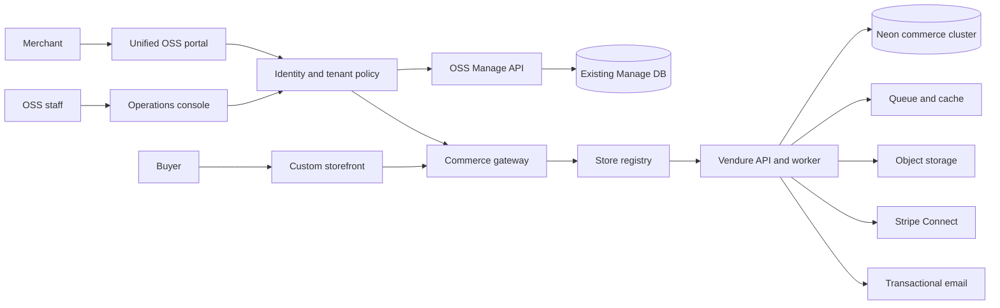

# OSS Commerce — platform architecture research
Research direction | 14 November 2026 | Not an implementation mandate

## Product thesis
OneSimpleSite sells bespoke storefront development plus managed commerce (£50/month target, separate build fee, optional transparent transaction commission). Merchants own their businesses, domains, catalogue, customer relationships and payment accounts; OSS operates the software. A shared commerce service is not a marketplace: no cross-merchant basket or pooled customer funds. Non-commerce clients remain supported by OSS Manage.

## Evidence and engine choice
Shopify publicly describes pods serving subsets of stores, each with application infrastructure and a MySQL shard, and a routing table assigning stores to pods. This validates the pattern, not an assertion that Shopify uses Neon or Vendure.
- https://shopify.engineering/shopify-made-patterns-in-our-rails-apps
- https://shopify.engineering/mysql-database-shard-balancing-terabyte-scale
Vendure documents independent shops using channels, prices, stock locations, payment/shipping configuration and scoped admin roles. Its default channel contains all entities; many entities can belong to multiple channels. Channel membership is NOT a hard isolation boundary. Global settings and unscoped entities need special treatment.
- https://docs.vendure.io/current/framework/core-concepts/channels
- https://docs.vendure.io/current/framework/core-concepts/roles
- https://docs.vendure.io/current/framework/core-concepts/permissions
- https://github.com/vendurehq/vendure (GPLv3 core; verify pinned version and commercial plugins; SaaS network use generally does not trigger GPL source distribution, distribution may; legal review before commercial rollout).
Medusa (https://github.com/medusajs/medusa, MIT core) is an alternative. Sales channels are not merchant tenancy by themselves. Evaluate marketplace/custom tenancy, permissions and separate deployments if Vendure isolation fails. Do not build an engine from scratch. Compare actual versioned code, licenses, migrations and support before selection. Vendure is preferred for a two-store proof, not irrevocably selected.

## System map

One login and shared navigation; independent service ownership. Existing OSS Manage retains contracts, CRM, projects, invoices, support, hosting, renewals and client organisation records. Commerce owns catalogues, orders, customers, stock, payment references and fulfilment. Identity/organisation membership and entitlements are authoritative in a shared identity/control-plane service (reuse existing auth if suitable after inspecting Manage). Stable organisation_id, store_id, user_id; map to Vendure channel ID and cluster ID. Commerce must not read Manage tables directly or vice versa. Use authenticated API contracts, versioned events/outbox, idempotent consumers and reconciliation. Never duplicate passwords, full customer data or payment secrets. Existing Manage integration remains a discovery item: its code/schema/auth were not inspected.

## Deployment and tenancy
- Vercel: Next.js merchant portal, OSS operations console and independently designed client storefronts (shared commerce SDK/design-independent checkout). Separate builds/domains as needed; preview endpoints require authentication. Route hostname to verified store, never trust client-submitted tenant.
- Railway: persistent Vendure Node server and worker, health checks, private admin service where possible; API gateway/BFF validates identity, membership, entitlement, operation, store, channel and resource ownership. Browser never gets DB credentials or shared superadmin token.
- Neon: one production project/cluster initially, separate dev and staging projects with synthetic data. Branches for ephemeral PRs, automatic expiry; never copy real PII to previews. Production protected credentials, dedicated migration role, TLS, least privilege runtime roles; direct connection for migrations and session-dependent features; size pools across API/worker replicas; validate PgBouncer compatibility.
- R2/S3-compatible storage: tenant prefixes, ownership validation, private signed URLs where needed, MIME sniffing, size limits, malware handling, tenant-scoped CDN cache. Redis/BullMQ if justified by queue/throughput; durable jobs, retry/backoff/dead letter. Resend or equivalent with authenticated sending domains and bounce suppression.
- Store registry: store_id, organisation_id, cluster_id, channel_id, verified hostnames, region, lifecycle, entitlement version; no secrets. Route by registry with bounded cache and invalidation. First cluster commerce-eu-01; add pods based on CPU, DB connections/IO, queue lag, latency, storage, incident blast radius or contractual residency. Design export/import and relocation now; no premature sharding. Dedicated cluster for isolation requirements, not default.
- Distinct environment Stripe accounts/test keys, webhook secrets, email sinks, R2 buckets and DNS; never send production emails or process live charges in staging. Secrets in platform vault, not Git or frontend. Production paid capacity, PITR and tested restore. https://neon.com/docs/connect/connection-pooling ; https://neon.com/blog/announcing-point-in-time-restore

## Isolation and data model
One organisation may own multiple stores; one store starts with one channel and one seller. Map store to channel server-side; no merchant default channel/global roles; prevent shared entities across unrelated stores. Global tax/zone/settings and role administration are OSS-only until proven safe. Explicitly audit Customer, CustomerGroup, address, asset, search index, stock location, promotions, refunds, jobs, exports, analytics, custom fields, GraphQL nested resolvers and all mutations. Never rely on UI visibility, channel header or UUID secrecy. Each plugin resolver/service enforces tenant ownership. RLS on OSS-owned tenant tables as defence in depth with non-owner runtime role; do not blindly retrofit RLS onto Vendure ORM tables without compatibility proof. Tenant-qualified cache keys, jobs, events, file access, signed tokens and rate limits. No public Admin API; scoped service/merchant identities, no universal service token in request path. Test direct API access, cross-store IDs and forged headers. Separate shopper accounts per merchant; test Vendure customer identity/email uniqueness and shared default-channel behaviour; if isolation cannot be guaranteed, use separate engine/database per merchant or isolated pods. Fail closed.

## Service contracts and lifecycle
Identity membership + entitlements -> store provisioning -> channel/seller -> stock/tax/shipping defaults -> merchant role -> Stripe onboarding -> domain verification -> preview -> launch. Provision as durable state machine with idempotent steps and compensations; retry safely on partial failure; no store live until all readiness gates pass. States draft, provisioning, configuring, ready, live, restricted, suspended, offboarding, archived; payment readiness independently tracked. Store switch validates membership every request; invalid store returns 403/404 without leakage. Entitlements never substitute for authorization.

## Architectural validation gates
Two unrelated seeded merchants with identical SKU/email scenarios: verify every read/write boundary, shopper accounts, price/stock isolation, payments/refunds, exports and cache. Load test checkout and concurrent inventory reservation. Test failed provisioning, webhook replay/out-of-order, backups/restore, merchant export and cluster relocation. Reject shared deployment if any cross-tenant leak cannot be fixed cleanly. Record engine decision and pinned versions after proof. No infrastructure has been provisioned by this research.
