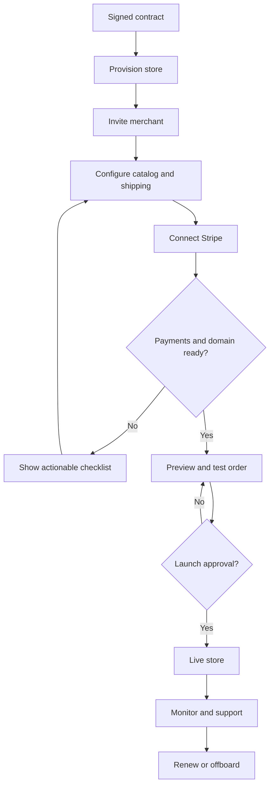

# OSS Commerce — product and operating model
Research direction, not a rigid build script. UK physical goods first; defer marketplace, international tax automation and subscriptions until requirements exist.

## Product surfaces and ownership
**Merchant portal:** single OSS account, organisation/store switcher, Overview, Orders, Products, Inventory, Customers, Discounts, Analytics, Storefront, Settings, plus existing Website, Contracts, Billing and Support. Non-commerce clients don't see commerce navigation; commerce clients do not need another login. Merchant portal is not buyer account. 
**OSS operations console:** Clients/stores, onboarding, access requests, deployment/domain health, billing/entitlements, support queues, incidents, payment exceptions, audit and platform metrics. Separate privileged identity/session and MFA, no default global merchant impersonation.
**Buyer storefront:** custom visual design per client; shared reliable product/cart/checkout/order tracking primitives. Merchant owns domain and consumer relationship.
**Vendure native admin:** internal engineering/fallback only, tightly restricted. Do not expose shared superadmin to merchants or use it as the customer-facing design.

## Partner access inspired by IONOS and Shopify
IONOS Partner Portal enables client access requests and full/partial access depending on service; Shopify collaborators use merchant-approved permissions and can be removed. Reference: https://www.ionos.co.uk/partners ; https://help.shopify.com/en/manual/your-account/staff-accounts/collaborator-accounts ; https://help.shopify.com/en/partners/dashboard/managing-stores
OSS adaptation: owner creates or approves organisation invitation, chooses stores, scopes and expiry; owner sees requester, purpose and access history. Pending -> approved/declined/expired -> active -> revoked. No shared credentials. OSS support tickets can request temporary read-only access with purpose; write access separately approved, explicit operation preview and confirmation, time limited (suggest 60 min), MFA step-up and immutable audit. Emergency break-glass only designated staff with reason, alerts and retrospective review; do not make routine access dependent on emergency privilege. Revocation invalidates sessions/tokens and queued actions. Owner transfer requires verified acceptance, step-up and notification; cannot remove last owner. Offboarding revokes grants, preserves records per retention policy.
Roles: merchant owner (billing/team/payment onboarding), manager (catalogue/orders/discounts), fulfilment (orders/shipping limited PII), analyst (read aggregate reports), support agent (ticket-scoped reads), OSS engineer (technical diagnostics without default buyer data), finance (reconciliation), platform admin (restricted global operations). Permissions are explicit operations, not just screen access. Default deny. Negative tests for every role and tenant.

## Functional coverage and decisions
| Domain | Expected behaviour | Failure/exception |
|---|---|---|
| Onboarding | Contract signed in Manage; entitlement creates organisation/store; invite owner; currency GBP, UK shipping/tax defaults, payment onboarding, preview, launch approval | Missing signature/payment/DNS -> checklist and retry; duplicate request idempotent; no live store until ready |
| Catalogue | Draft/published/archived products; variants, SKU, prices, tax class, collections, images, SEO, bulk CSV import/export with preview | Invalid price/SKU/CSV row -> row errors; duplicate SKU policy per store; referenced product archive not destructive delete |
| Inventory | Per-location on-hand, allocated, available; stock adjustments reason and audit; threshold alerts | Concurrent checkout atomically reserves stock; abandoned cart expiry; no negative availability unless explicit backorder policy |
| Orders | Search/filter, detail, payment/fulfilment status separately; notes, timeline, tracking, partial fulfilment and cancellation | Failed payment not fulfil; duplicate webhook no duplicate order; cancellation releases stock; partial returns tracked independently |
| Checkout | Guest checkout; address, shipping quote, totals, discount, payment, receipt; server recalculates prices and stock | Invalid address, expired promotion, stock changes or SCA failure -> clear recovery; never charge stale total; pending order reconciliation |
| Payments | Stripe Connect merchant account; payment readiness and payout status, refunds, dispute events; separate OSS invoice | Missing capabilities -> block payment; failed/partial refund -> visible state, no false success; financial records immutable |
| Customers | Store-local customer accounts, guest purchase history, contact/consent, export and deletion request | Same email across unrelated stores isolated; retention/legal obligations checked; unsubscribe separate marketing from receipts |
| Discounts | Codes, automatic promotions, validity window, minimum spend, usage limit, eligibility, stacking rules | Expired/invalid -> explanatory error; atomic usage limits; define precedence, test rounding/tax |
| Shipping | Zones, rates, free threshold, tracked fulfilment, local pickup later | Unsupported postcode -> no checkout; carrier failure retry/manual fallback; partial shipments |
| Tax | GBP minor units, VAT-inclusive/exclusive choice, tax categories, receipt breakdown; merchant config and VAT registration verified | Do not guess tax registration; refunds allocate tax/discount accurately; international deferred |
| Analytics | Gross/net sales, refunds, orders, average order value, top products, low stock; date/timezone controls | Zero vs unavailable vs stale distinguished; reconcile against ledger; don't call GMV profit |
| Storefront | Preview, custom domain verification, SSL, deployment health, theme version, SEO metadata, legal pages | DNS pending, certificate/deploy failure -> status + retry; rollback prior version; domain ownership verification |
| Settings/team | Store info, branding, currencies, shipping, taxes, roles, invitations, payment connection | Step-up for sensitive changes; scope role; audit before/after; prohibit unsafe currency changes after transactions |
| Support | Ticket inbox, category/severity, store/order context, attachments, SLA timestamps, access grants, resolution history | Escalate checkout outage; no secrets/card details in tickets; tenant scoped attachments; owner sees history |
| Billing | Existing Manage owns OSS £50 subscription, plan entitlements, invoice history, upgrade/change requests | Failed renewal grace/retry, notify, restrict new checkout only per contract; preserve existing order fulfilment/export |
| Offboarding | Notice, export products/orders/customers subject to law, transfer domain, revoke access, disconnect payment account, archive | Outstanding refunds/disputes retained and handled; no hostage data; scheduled deletion/backup expiry; verify export integrity |

## Business processes

Order lifecycle is not one linear status: payment (pending/authorised/captured/failed/refunded/disputed), fulfilment (unfulfilled/partial/fulfilled/returned), order (open/cancelled/completed). Use Vendure's actual state machines and extensions, map UI wording explicitly. Webhooks verified signature + event ID + account + order metadata; idempotent ledger, handle out-of-order events, reconciliation jobs. Refund UI shows quantity, reason, amount, tax, shipping, application-fee policy, restock decision; confirm once, poll pending, record result. Never manually mark paid merely to clear an alert.

## Support and operational standards
Priority examples P1 checkout down/security incident, P2 merchant blocked, P3 normal request. Define business hours and response targets in contract, not aspirational 24/7 promise. Shared support dashboard includes tenant ID, store domain, correlation ID, environment, event history, current incidents, failed jobs, deployment status; redact PII. Runbooks for checkout outage, webhook lag, oversell, compromised account, wrong-tenant access, failed release, DNS, restore. Central alerts, owner, escalation, status page, incident timeline and postmortem. Track support minutes per merchant; routine platform fixes included, custom design/content/integration work quoted separately. No claims of zero support even with robust engineering.

## Validation and delivery
Foundation: inspect existing Manage API/auth/data model, choose canonical identity and integration contract; two-store engine spike with isolation tests. Then vertical slice from merchant onboarding through product -> cart -> test payment -> order -> fulfilment -> refund. Build merchant and support workflows in parallel with data contracts and real states. Extend inventory, promos, analytics, domain, billing and offboarding only on tested primitives. Accessibility, mobile, failure states and security tests travel with each slice. Launch pilot only after real merchant approval, payment risk/legal review, backups and runbooks, tested export, load tests and cross-tenant tests. No migration of existing Shopify customers without consent or verified parity.
