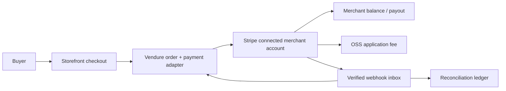

# OSS Commerce — payments, assurance and economics
## Payments and commercial model
Stripe Connect direct charges are the initial candidate: charge created on merchant connected account, merchant receives proceeds, OSS receives disclosed application_fee_amount. Prefer Stripe-hosted onboarding and Stripe-managed payment pricing where eligible; confirm account/controller configuration, application fees, liability, fees and UK eligibility with Stripe before launch. Direct charges are not automatically liability-free. Destination charges/separate charges and transfers introduce different balance/dispute responsibilities; avoid unless needed. No holding merchant funds in OSS bank account. Merchant is seller of record; OSS provides software; review contracts, regulatory position, VAT treatment and consumer law with qualified advisers.
Sources: https://docs.stripe.com/connect/direct-charges ; https://docs.stripe.com/connect/application-fees ; https://stripe.com/gb/connect/pricing ; https://stripe.com/gb/pricing ; https://docs.stripe.com/connect/hosted-onboarding

Never store PAN/CVC. Use Stripe Checkout or Payment Element with appropriate PCI scope confirmation; validate SCA/3DS, failed/cancelled and asynchronous payments. Vendure's standard Stripe plugin is not assumed to support Connect application fees; inspect and build a scoped PaymentMethodHandler/plugin or adapter. Server determines account from store registry, amount from authoritative order, fee policy from versioned contract. Stripe account ID, PaymentIntent, charge, order ID and currency must reconcile. Webhook signature on raw body, event/account dedup, retry and out-of-order handling, retrieve current provider state as needed. Separate test/live keys and endpoints. Refunds specify application fee treatment; partial refunds, disputes, chargebacks, fees and payout failures must reconcile; no double refund on retries. Stripe account capability updates restrict checkout when needed. Merchant sees payouts via connected Stripe dashboard or embedded components where supported, not fictional balances.
 
## Planning economics (illustrative, not quotes)
GBP, £50 ex-VAT recurring per merchant, separate upfront development, 0.5% application fee on eligible captured volume, £2,000 monthly GMV/client -> £10 gross fee per client. Standard UK card example 1.5% + 20p (verify current published pricing), borne by merchant; Connect pricing depends on configuration and can include active-account and payout fees. Refunds, international cards, VAT, chargebacks and payment fees differ. Commission is not net profit.
| Merchants | Subscription | Gross commission | Shared infra allowance | Support (0.5h x £25) | Gross contribution before Connect/other overhead |
|---:|---:|---:|---:|---:|---:|
| 10 | £500 | £100 | £150 | £125 | £325 |
| 50 | £2,500 | £500 | £350 | £625 | £2,025 |
| 100 | £5,000 | £1,000 | £650 | £1,250 | £4,100 |
These are scenario assumptions, not tested capacity or supplier prices. Exclude initial engineering, Vercel usage/seat allocation beyond allowance, accounting, insurance, tax, Connect fees and contingencies; include them before pricing. At £50 VAT-inclusive, net revenue is £41.67 if VAT applies at 20%. Sensitivity: 1.5 hours support at £25 consumes £37.50 per merchant before infra. Track actual cost per active store, orders, DB compute/storage/egress, worker time, email, image storage, deployment usage, incident time and commission after refunds/fees. Set usage limits, support scope and higher tiers; no unlimited custom changes.
Infrastructure pricing sources to recheck at provisioning: https://neon.com/pricing ; https://railway.com/pricing ; https://vercel.com/pricing ; https://developers.cloudflare.com/r2/pricing/ ; https://resend.com/pricing . Establish budgets/alerts, production paid capacity and restore retention. Choose regions together; confirm UK/EU residency and transfers.

## Security and privacy assurance
Threat model: malicious merchant, compromised OSS support, buyer enumeration, forged store header, cross-tenant GraphQL nested access, bulk import abuse, webhook replay, malicious files, cache poisoning, credential leakage, dependency compromise, denial of service. Use OWASP ASVS/API Top 10 as checklist: https://owasp.org/www-project-application-security-verification-standard/ ; https://owasp.org/www-project-api-security/ .
- Identity: verified invitations, MFA for OSS and privileged merchants, session rotation/revocation, CSRF protection for cookie sessions, secure SameSite cookies, rate-limit login and recovery; never store raw reset tokens.
- Authorisation: deny by default, store membership + operation + resource owner on every server call, including nested fields, exports and async jobs. Tenant-specific service identities; privileged access separate and audited. Test direct API, not just hidden buttons.
- Data: TLS, encryption at rest, secrets rotation, least privilege, PII minimisation, log redaction, tenant-scoped exports/storage/search. GDPR data mapping, controller/processor allocation, DPA, subprocessor list, retention and deletion, subject requests, incident notification procedure; consult ICO https://ico.org.uk/for-organisations/uk-gdpr-guidance-and-resources/ . UK consumer returns/cancellation obligations and merchant policies require review.
- Reliability: database point-in-time recovery, object versioning/backup, encrypted off-platform export if appropriate, restore drills to isolated environment, measured RPO/RTO (proposed pilot targets RPO 1h/RTO 4h; validate before promising), health probes, queue monitoring, dashboards and alert ownership. Backward-compatible migrations, dry run, deploy worker/API compatibility, rollback plan; no automatic destructive schema sync.
- CI: lint/types/unit/integration, Playwright desktop/mobile, accessibility axe, secret/dependency scans, SBOM/licence check, migration test, tenant adversarial test, webhook replay/load test. Signed releases/approval for production, separate service credentials, protected deployment, feature flags and audit. Synthetic fixtures only. No production data in preview.
- Acceptance: two-store cross-read/write tests across every domain, same email/SKU, default channel/global roles, cache/storage/exports, support revocation and expired grants; concurrent last-unit purchases; SCA/timeout/duplicate payment; partial refund; failed provisioning/restore; merchant offboarding and export. Any leakage blocks launch. Independent security review before real payments.

## Decisions still open
Validate engine version and isolation, Manage auth integration, Stripe Connect configuration and commercial terms, VAT/contract treatment, hosting regions, support limits, actual infrastructure cost, pilot merchant and migration scope. No real infrastructure, payment account or production code has been created by this pack.
