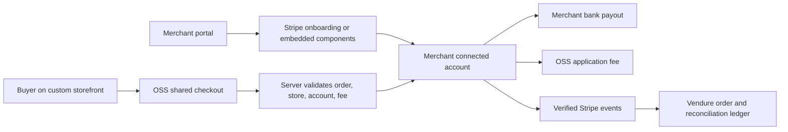

# OSS Commerce — payment and integration direction
14 November 2026 | Research supplement; preserve existing implementation and visual system.

## Decision: one platform integration, independent merchant accounts
Use Stripe Connect, not one ordinary OSS Stripe account collecting all customer sales. OSS platform credentials live server-side. Each merchant legal entity has its own connected account (acct_...), verification and payout bank account. Store registry maps store to authorised merchant/account, environment and fee agreement; multiple stores owned by the same legal merchant may share an account only if explicitly supported and reconciled. Never mix unrelated merchants. Prefer direct charges on connected accounts, Stripe-managed processing pricing and Stripe liability configuration where eligible. Merchant is seller of record; OSS sells software and technical services. Review terms/UK regulatory position before live launch. Do not promise that Connect removes all liability.

## Merchant experience
Portal Settings > Payments: Not configured -> Set up payments -> Stripe-hosted onboarding or Stripe Connect embedded account onboarding. Create/authorise connected account server-side; merchant supplies legal/business information, representative details, identity evidence, bank account and accepts Stripe agreements in Stripe-controlled UI. OSS may prefill permitted information with consent. No merchant API keys, no raw bank account or ID document storage by OSS. Embedded onboarding feels native; hosted onboarding is a reliable initial fallback. Existing Stripe users may connect eligible accounts through supported onboarding/OAuth for full-dashboard accounts; accounts already connected to another platform may require new account under same Stripe login. Do not assume Shopify Payments can be transferred. Evaluate current controller properties/Accounts v2 vs v1, dashboard access, requirement collection, fees and losses responsibility; choose Stripe-managed/full-dashboard configuration where available and suitable. Existing-account flow must use supported authorisation, validated state and redirect, never passwords.

AccountSession created server-side after merchant-owner authentication and store membership check; grant only necessary embedded components. Use Connect.js / react-connect-js for onboarding, payments, balances, payouts, account management and notifications where supported. Step-up authentication for sensitive changes, Stripe controls bank changes. Full Stripe dashboard link as fallback. Verify actual component availability per account configuration. Readiness based on provider capabilities, charges_enabled, payouts_enabled, requirements and restrictions, not return URL. Separate payments enabled from payout enabled; show pending verification, action required, restricted, disconnected, failed payout. Recheck on account updates; block checkout when charges unavailable; retain access to past orders/refunds and reconciliation as appropriate. Owner-visible fees, payout timing, masked bank info and activity. OSS support sees status and redacted diagnostics, never bank secrets.

## Payment flow

Use direct charges with connected account context (Stripe-Account header or SDK stripeAccount option). Create PaymentIntent or Checkout Session on merchant account, server-derived integer minor-unit total and application_fee_amount. Stripe.js initialised with correct connected account context and publishable key; no platform secret/browser. Payment Element + Express Checkout Element with cards, Apple Pay, Google Pay, Link as eligible. Register merchant checkout domains for connected accounts when required, handle HTTPS and domain changes. Evaluate Stripe-hosted Checkout vs embedded/custom payment UI against design and PCI scope; no raw PAN/CVC. Test SCA/3DS, redirect, asynchronous methods, amount changes, inventory reservation, double submission, failure, timeout, cancellation and reconciliation. Do not fulfil from client success redirect. Pin Stripe API version and confirm Vendure plugin compatibility; implement connected-account PaymentMethodHandler/adapter if standard plugin lacks necessary context. Verify webhook raw-body signature, environment/account, event dedup, order/amount/currency mapping; durable inbox, retry, out-of-order reconciliation. Separate live/test credentials and accounts. Refunds from correct connected account; explicit application-fee refund policy (including partial), dispute and negative balance procedures. Never assume fees returned. Financial ledger records gross, processing fee, application fee, refund, dispute and net; reconcile provider balance transactions/payouts, immutable event history, exports.

## Economics
Stripe UK Connect pricing currently states no extra account/payout fees when Stripe handles merchant pricing; application fees are listed as supported, subject to account/configuration/terms. Standard UK card example 1.5% + 20p, OSS 0.5% merchant-borne disclosed platform service fee: £100 order -> £1.70 Stripe, £0.50 OSS, £97.80 merchant before other adjustments. Not guaranteed for every payment method. Stripe-managed revenue share is separate and requires eligibility. Avoid platform-controlled processing pricing initially: UK listed £2 active account/month and 0.25% + 10p per payout, plus applicable funds routing/other fees depending on configuration; get written confirmation of exact schedule. £49.99 / £99 subscriptions separately via OSS billing, not shopper funds; no buyer card surcharge. Fee rules versioned by agreement, VAT and rounding reviewed, merchant statements and refund terms. No hardcoded commercial commitments. 
Official sources: https://stripe.com/gb/connect/pricing ; https://docs.stripe.com/connect/direct-charges ; https://docs.stripe.com/connect/embedded-onboarding ; https://docs.stripe.com/connect/get-started-connect-embedded-components ; https://docs.stripe.com/connect/hosted-onboarding ; https://docs.stripe.com/payments/payment-methods/pmd-registration ; https://docs.stripe.com/payments/express-checkout-element ; https://support.stripe.com/questions/security-permissions-and-access-levels-when-connecting-your-stripe-account-to-a-third-party-platform ; https://github.com/stripe-samples ; https://github.com/stripe/react-connect-js

## Initial integration catalogue — staged by readiness, not all at once
Payments: cards, Apple Pay, Google Pay, Link first; PayPal, Klarna, Clearpay optional after checking UK Connect account/payment method availability, fees, refunds, disputes, merchant eligibility, buyer disclosures and relevant credit/consumer requirements. PayPal may need separate provider connection if Stripe route unavailable; do not misrepresent BNPL as universally enabled. Stripe Tax optional, merchant-specific registration/product tax codes and tax liability; verify pricing and Connect support. Native tax setup remains available.
Shipping: merchant-configured manual rates/zones, local pickup, tracking first; Royal Mail Click & Drop connection (account-specific API access; check label/payment capabilities); ShipStation multi-carrier research, DPD/Evri/InPost/Parcelforce via supported carrier accounts/services. Quote/label purchase with explicit price confirmation, merchant pays, idempotency, parcel dimensions/weight/address validation, batch labels, tracking, partial shipments, void/refund label support where offered, failed label recovery, return labels, webhook/polling, reconciliation. Do not mark dispatched solely on label purchase. Manual fulfilment fallback. https://api.parcel.royalmail.com/ ; https://docs.shipstation.com/
Address: Postcodes.io free postcode lookup/geography, not full address autocomplete. Ideal Postcodes paid full address lookup; merchant usage budget, server proxy, manual entry fallback, rate limits and postcode normalization. https://postcodes.io/ ; https://ideal-postcodes.co.uk/
Search: evaluate existing Vendure search first; Meilisearch optional for typo tolerance/facets, tenant-qualified indexes/filters and scoped search tokens, index lag/rebuild, no private PII. https://github.com/meilisearch/meilisearch
Media: existing R2 + image optimization first; Cloudinary optional transformation pipeline, cost/egress and tenant asset isolation. https://cloudinary.com/documentation
Print-on-demand: Printful / Printify merchant-authorised accounts, product/variant mapping, shipping quotes, order submission after confirmed payment, supplier rejection, cancellation, tracking, duplicate prevention, cost and margin checks; no auto-order before validation. https://developers.printful.com/ ; https://developers.printify.com/
Fulfilment: ShipBob warehouse connection, SKU/location mapping, inventory sync, fulfilment/returns and reconciliation; not needed for all merchants. https://developer.shipbob.com/
Identifiers: GS1 UK GTIN validation/check digit and merchant-assigned barcodes; legitimate GTIN ownership/licensing, not arbitrary generated numbers. https://www.gs1uk.org/
Automation: Vendure events + durable queue/outbox and scoped rule engine first. Study Activepieces, Windmill, Trigger.dev and React Flow for workflows, retries, scheduling and UI; verify current licenses and embedded SaaS restrictions before reuse. https://github.com/activepieces/activepieces ; https://github.com/windmill-labs/windmill ; https://github.com/triggerdotdev/trigger.dev ; https://github.com/xyflow/xyflow . Trigger/conditions/actions, versioned definitions, test run, pause, execution history, idempotency, dead letters, rate limits, loop prevention, consent for marketing, manual replay with audit. Start with paid order notifications, low stock, dispatch emails and fulfilment reminders; abandoned checkout only when lawful. React Email/Resend for branded transactional templates.

## Shared integration framework
Provider adapter contract: connect/authorise, validate, capabilities, sync, handle event, disconnect, health; OAuth where supported, API keys only where necessary, encrypted secret storage, scope and refresh/revocation. Tenant/store/environment-bound connection ID and external resource mapping; no global credentials exposed. Provider-specific capability manifest, sandbox availability, dependencies, fees, approval status and supported regions. States available/configuring/pending/connected/degraded/revoked/disabled; actual backend checks, no fake connected state. Merchant portal cards -> detail -> connection wizard -> settings, permissions, test, status, last sync, errors, disconnect. OSS console scoped support access, redacted errors, retry/replay, provider outage status, audit. Durable job queue, per-provider rate limits, retry/backoff, idempotency, dead-letter and reconciliation. Data minimisation and consent; no arbitrary outbound URLs or SSRF. Feature flags and plan entitlements separate from authorisation. Manual fallback and export. Provider costs disclosed; postage, paid provider accounts, address lookups etc not silently absorbed in £49.99.

## Delivery gates
Inspect existing code and preserve working theme. First complete two independent merchant onboarding flows with different custom domains, Stripe sandbox payments and separate account context; test wallets, failed verification, revoked account, payout failure, refund, webhook replay, and cross-tenant attacks. Next shipping end-to-end including actual label eligibility/sandbox; then address/search/media, optional fulfilment and automation adapters as capacity permits. Each integration requires real provider docs, credentials/approval, sandbox proof, failure handling, security tests and cost checks before advertised as available. No live Stripe setup or integration code created by this research. 
